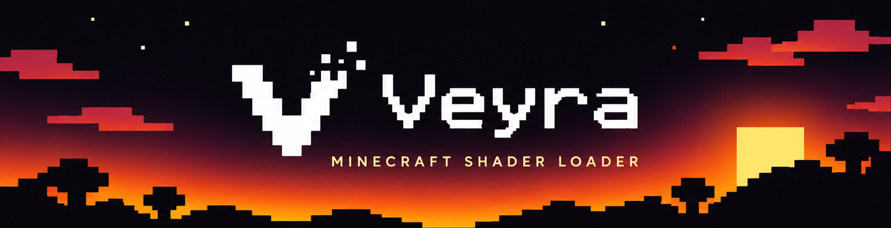

<div align="center">



**Shader packs, powered by VulkanMod.**

A client-side shader loader for Minecraft that brings a supported subset of Iris-style shader packs to Vulkan.

[](https://github.com/glebKovshov/Veyra/actions/workflows/build.yml)
[](#requirements)
[](#requirements)
[](LICENSE)

[**Download**](https://github.com/glebKovshov/Veyra/releases) / [Release notes](RELEASE_NOTES.md) / [Report an issue](https://github.com/glebKovshov/Veyra/issues) / [Contribute](CONTRIBUTING.md)

</div>

---

## About

Veyra loads shader pack programs into VulkanMod's rendering pipeline: terrain and entities, shadows, post-processing, and supported compute stages. Keep using the familiar `shaderpacks/` folder and configure your packs from an Iris-style menu, without modifying their archives.

- **An in-game shader menu.** Open Shader Settings from Video Settings or press **F6**. Choose packs, adjust options and quality profiles, and refresh edited shaders.
- **More than post-processing.** Supported programs cover world geometry, water, clouds, shadows, multiple color targets, and compute passes.
- **Resource-pack materials.** Static and animated normal and specular maps are supported for terrain and resource-backed entity textures.
- **Safe pack replacement.** A failed shader compilation keeps the previously loaded pack active.

Veyra is an independent project. It requires VulkanMod; it does not use Iris as a runtime dependency.

## Requirements

| Component | Required version |
| --- | --- |
| Minecraft: Java Edition | **1.21.11** |
| Fabric Loader | **0.18.4 or newer** |
| VulkanMod | **0.6.8** |
| Java | **21 or newer** |
| Graphics | A GPU and driver supported by VulkanMod |

VulkanMod's exact version matters: Veyra integrates with its internal rendering classes. Other versions require compatibility testing.

## Installation

1. Install [Fabric Loader](https://fabricmc.net/use/installer/) for Minecraft **1.21.11** and [VulkanMod 0.6.8](https://github.com/xCollateral/VulkanMod/releases).
2. Download the Veyra mod JAR from [GitHub Releases](https://github.com/glebKovshov/Veyra/releases) and put it in your instance's `mods/` folder alongside VulkanMod. Remove older Veyra JARs; the `-sources.jar` is for development.
3. Put a shader pack ZIP or folder in the instance's `shaderpacks/` directory.
4. Launch the game and open **Options / Video Settings / Shader Settings**, or press **F6**.
5. Select a pack and press **Apply** or **Done**. Use **Shader Pack Settings** to change its options and profile.

The published VulkanMod JAR includes its required Fabric API modules and Vulkan libraries. Shader packs are downloaded separately and are not redistributed by Veyra.

## Shader pack compatibility

Veyra supports a subset of the Iris shader pack interface. Compatibility depends on the pack version, profile, and enabled features; pixel parity with Iris is not guaranteed.

The project's validation covers **Complementary Reimagined and Unbound r5.9.3**, **BSL 10.1.8**, **Sildur v2.02**, and, in 1.1.0, **Photon v1.4**. These are tested configurations, not a promise that every option works.

Known limits include:

- Geometry and tessellation shader stages are unsupported.
- Up to **16 logical color buffers** and **8 simultaneous outputs** are supported.
- Photon's LPV/colored lights, matrix-typed and integer-vector custom uniforms, and 1D/RECTANGLE raw textures are unsupported.
- Pack loading compiles shaders on the render thread and can pause the game.
- Hardware validation currently covers an **RTX 3070** and **Lavapipe**; other GPUs are untested.

See the [compatibility reference](COMPATIBILITY.md) for the precise contract and [release notes](RELEASE_NOTES.md) for current validation results and visual differences.

## Troubleshooting

Use **Refresh** in Shader Settings to rescan packs and recompile the active pack. Use the **Shaders** toggle to disable shaders. Pack options are saved under `veyra/options/`; your shader pack sources stay unchanged.

Before [opening an issue](https://github.com/glebKovshov/Veyra/issues), check the required versions and reproduce the problem with a minimal mod set. Include:

- Veyra, Minecraft, Fabric Loader, and VulkanMod versions;
- GPU, driver, operating system, and Java version;
- shader pack version, profile, and changed options;
- steps to reproduce, `logs/latest.log`, and a crash report if one exists;
- a screenshot for visual problems.

Review logs for personal information before uploading them.

## Development and documentation

Build with **JDK 21** and the included Gradle wrapper:

```sh
./gradlew build validateShaders
```

On Windows, use `.\gradlew.bat build validateShaders`. Built JARs are written to `build/libs/`.

| Guide | Contents |
| --- | --- |
| [Contributing](CONTRIBUTING.md) | Build, tests, example packs, and pull requests |
| [Shader development](docs/SHADER_GUIDE.md) | Program inputs, uniforms, buffers, and examples |
| [Compatibility](COMPATIBILITY.md) | Supported behavior and known gaps |
| [Architecture](ARCHITECTURE.md) | Rendering integration and project structure |
| [Validation](VALIDATION.md) | Test procedures and recorded evidence |
| [1.0 stability report](STABILITY_1_0.md) | Historical release gates and baseline |
| [Changelog](CHANGELOG.md) | Change history |

## Credits and license

Built on [VulkanMod](https://github.com/xCollateral/VulkanMod) and [Fabric](https://fabricmc.net/), with shader pack compatibility informed by [Iris](https://github.com/IrisShaders/Iris). Thanks to their contributors and to shader pack authors for their work.

Veyra is licensed under the [MIT License](LICENSE). See [third-party notices](THIRD_PARTY_NOTICES.md) for dependency licenses and attribution.

<div align="center">
  <br>
  
</div>
